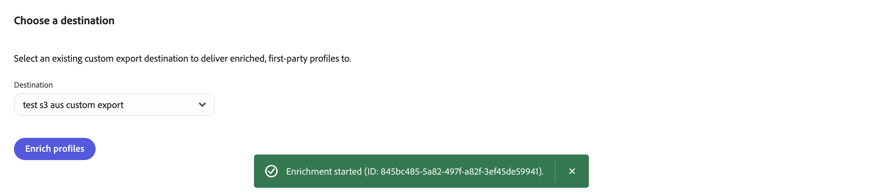

# 交易台配置文件扩充(Alpha)

使用来自[!DNL The Trade Desk]的原始事件数据流(REDS)展示日志数据馈送将扩充属性和付费媒体上下文导出到您的第一方配置文件。

CSV文件到达您的[!DNL Amazon S3]导出目标后，将其摄取到[!DNL Adobe Real-Time CDP]。 在此版本中，导出文件不会自动更新用户档案或激活体验。 [!DNL Adobe Real-Time CDP]中的自动配置文件扩充计划用于后续版本。

广告曝光度可将上下文添加到客户个人资料。 它不会确认参与、购买意图或长期利益。

## 准备扩充 {#prepare-for-enrichment}

在开始之前，请与管理员、媒体团队和数据团队合作，确保您拥有：

* 访问[!DNL Adobe Real-Time CDP Collaboration]和已签署的参与协议。
* 访问书已完成，并显示[!DNL The Trade Desk]以授权REDS馈送配置。
* [!DNL Adobe Real-Time CDP Collaboration]中可用的第一方受众，使用经过哈希处理的电子邮件地址或电话号码。 此版本中不支持其他标识符。
* 已配置为接收扩充输出的[!DNL Amazon S3]目标。
* 将传递的文件摄取到[!DNL Adobe Real-Time CDP]的进程。

### 授权源信息源 {#authorize-source-feed}

要授权REDS日志直接传递到Adobe，请完成[!DNL The Trade Desk]提供的访问信件。

[!DNL The Trade Desk]配置源信息源，Adobe配置访问和摄取。 在创建项目之前，请确认连接处于活动状态并且信息源已就绪。

处理之后，扩充输出文件将到达您的导出目标。

### 准备下游摄取 {#prepare-downstream-ingestion}

提交后，请让您的[!DNL Adobe Real-Time CDP]管理员或技术支持团队摄取该文件。

## 连接和创建项目 {#connect-create-projects}

填写连接对话框中的访问信函，并保存您的合作伙伴ID。 等待Adobe确认收到REDS日志，然后再创建项目。 创建项目会启动扩充作业，该作业需要您的合作伙伴ID和日志。

### 与合作伙伴建立联系 {#connect-partner}

若要与[!DNL The Trade Desk]连接，请在&#x200B;**[!UICONTROL 连接]**&#x200B;中打开&#x200B;**[!UICONTROL 发现协作者]**&#x200B;并搜索合作伙伴。

![Collaborator目录列出了[!DNL The Trade Desk]及其[!UICONTROL 连接]选项。](../../../assets/collaborate/advertising-platforms/discover-collaborators-trade-desk.png){zoomable="yes"}

为[!DNL The Trade Desk]选择&#x200B;**[!UICONTROL 连接]**，然后按照连接对话框中的说明操作。

![连接对话框说明[!DNL The Trade Desk].](../../../assets/collaborate/advertising-platforms/trade-desk-connection-instructions.png){zoomable="yes"}的REDS授权和合作伙伴ID设置

连接处于活动状态后，打开&#x200B;**[!UICONTROL 连接设置]**&#x200B;并转到&#x200B;**[!UICONTROL 广告商信息]**。 要更新现有信息，请选择&#x200B;**[!UICONTROL 编辑]**。 要输入新信息，请选择&#x200B;**[!UICONTROL 添加]**。

![活动连接设置显示[!UICONTROL 广告商信息]和[!UICONTROL 编辑]控件。](../../../assets/collaborate/advertising-platforms/trade-desk-connection-settings.png){zoomable="yes"}

若要保存您的广告商信息，请在&#x200B;**[!UICONTROL 合作伙伴ID]**&#x200B;和&#x200B;**[!UICONTROL 合作伙伴名称]**&#x200B;中输入ID和合作伙伴名称，然后选择&#x200B;**[!UICONTROL 保存]**。 您的合作伙伴ID显示在您的[!DNL The Trade Desk]帐户中的&#x200B;**[!UICONTROL 名额标识符]**&#x200B;下。

![“广告商信息”对话框具有必填的“合作伙伴ID”和“合作伙伴名称”字段以及[!UICONTROL 保存]控件。](../../../assets/collaborate/advertising-platforms/trade-desk-advertiser-partner-info-dialog.png){zoomable="yes"}

保存广告商信息后，请等待Adobe确认收到REDS日志，然后再创建项目。

### 创建项目 {#create-project}

若要创建项目，请转到&#x200B;**[!UICONTROL 协作]**&#x200B;并选择&#x200B;**[!UICONTROL 我的项目]**，然后&#x200B;**[!UICONTROL 创建项目]**&#x200B;或添加图标（）。

在&#x200B;**[!UICONTROL 创建项目]**&#x200B;中，从&#x200B;**[!UICONTROL 协作者]**&#x200B;中选择[!DNL The Trade Desk]。

![[!UICONTROL 创建项目]表单列出了[!DNL The Trade Desk]并包含项目名称、说明和图像字段。](../../../assets/collaborate/advertising-platforms/trade-desk-create-project.png){zoomable="yes"}

要识别项目，请输入&#x200B;**[!UICONTROL 项目名称]**&#x200B;和&#x200B;**[!UICONTROL 描述]**，然后选择图像。 项目详细信息完成后，选择&#x200B;**[!UICONTROL 创建]**。

有关一般项目管理，请参阅[创建和管理项目指南](/help/guide/collaborate/manage-projects.md)。

## 选择并导出属性 {#select-export-attributes}

要选择要导出的扩充属性，请打开项目并选择&#x200B;**[!UICONTROL 扩充]**。 要了解信号可用性，请在选择要使用的属性之前查看每个属性的覆盖范围值。

![[!UICONTROL 扩充]页面按类别对可选信号进行分组并显示覆盖率值。](../../../assets/collaborate/advertising-platforms/enrich-attribute-selection.png){zoomable="yes"}

<!-- TODO: Replace the destination screenshot with one showing the [!UICONTROL Export Attributes] action. -->

选择为扩充输出配置的[!DNL Amazon S3]导出目标。 如果需要配置目标，请参阅[配置和管理云存储目标](/help/guide/destinations/manage-destinations.md)。

<!-- ![The [!UICONTROL Choose a destination] screen lists a destination and the [!UICONTROL Export Attributes] action.](../../../assets/collaborate/advertising-platforms/enrich-choose-destination.png){zoomable="yes"} -->

查看选定的属性和目标，然后选择&#x200B;**[!UICONTROL 导出属性]**。

<!-- {zoomable="yes"} -->

如果您的目标配置正确，则提交导出会开始投放。 提交导出后，请验证是否在[!DNL Adobe Real-Time CDP Collaboration]之外成功传递文件。

在创建项目后，Adobe会每周处理扩充属性。 每次运行都使用过去90天的可用[!DNL The Trade Desk]数据。 每次导出都包括最近完成的运行中选定的属性。 要导出刷新的属性，请在稍后运行完成后请求再次导出。

### 可用的扩充信号 {#available-signals}

从四个类别的18个策划的信号中进行选择。 不支持自定义扩充表达式。

| 类别 | 信号 | 描述 |
| --- | --- | --- |
| 核心 | [!UICONTROL 上次公开日期] | 最近向广告展示身份信息的日期。 |
| 核心 | [!UICONTROL 曝光计数] | 曝光频率类别，而不是原始展示次数计数。 |
| 核心 | [!UICONTROL 潜在客户与重新定位] | 推定的接触分类，即潜在客户发现或再营销。 |
| 核心 | [!UICONTROL 显示的产品类别] | 在广告中促销的产品的推断类别。 |
| 核心 | [!UICONTROL 主要库存渠道] | 与广告曝光度关联的主库存渠道。 |
| 核心 | [!UICONTROL 主要设备类型] | 与广告曝光相关联的主要设备类型。 |
| 地域 | [!UICONTROL 城市] | 从广告上下文而非验证位置派生的城市信息。 |
| 地域 | [!UICONTROL 地区/州] | 来自广告上下文的区域或状态信息。 |
| 地域 | [!UICONTROL DMA] | 从广告上下文中派生的指定市场区域(DMA)信息。 |
| 联网电视(CTV) | [!UICONTROL CTV已公开] | 在连接的电视设备上进行广告曝光。 |
| 联网电视(CTV) | [!UICONTROL 实时流查看器] | 实时流库存中的广告曝光，而不是查看或参与证明。 |
| 联网电视(CTV) | [!UICONTROL PMP/高级曝光] | 私有市场(PMP)或私有合同风险，而不是经独立核实的高级库存。 |
| 内容亲和度 | [!UICONTROL 已连接电视/正在流式传输] | 与流内容相关的广告曝光。 |
| 内容亲和度 | [!UICONTROL 游戏玩家] | 与游戏内容、网站或应用程序相关的广告曝光。 |
| 内容亲和度 | [!UICONTROL 体育粉丝] | 与体育内容、网站或应用程序相关的广告曝光。 |
| 内容亲和度 | [!UICONTROL 新闻关注者] | 与新闻内容、网站或应用程序相关的广告曝光。 |
| 内容亲和度 | [!UICONTROL 音乐爱好者] | 与音乐内容、网站或应用程序相关的广告曝光。 |
| 内容亲和度 | [!UICONTROL 内容流派] | 与广告曝光度相关的内容流派。 |

地理信号描述的是广告背景，而不是经过验证的住宅或当前位置。 内容亲和信号无法确认个人兴趣或偏好。 当源信息不可用时，某些属性可能不包含值。

### 属性覆盖率 {#attribute-coverage}

覆盖率描述处理记录包括属性值的频率。 对于yes/no信号（如&#x200B;**[!UICONTROL CTV exposed]**），覆盖范围将计算值为true的记录。 覆盖范围不指示身份匹配率或接收属性的第一方用户档案的比例。

身份匹配、源信号可用性和摄取会影响配置文件更新。 范围未确认导出完成或配置文件更新。

### 工作流范围 {#workflow-scope}

要扩充来自[!DNL The Trade Desk]的数据，请使用策划的目录。 不能导出原始日志或创建自定义属性表达式。 不支持其他需求端平台(DSP)和供应端平台(SSP)集成。

此工作流不支持扩充机会发现、受众重叠分析或归因和增量衡量。

## 摄取并验证结果 {#ingest-validate-results}

提交后，请让您的[!DNL Adobe Real-Time CDP]管理员或技术支持团队摄取该文件。

### 输出文件 {#output-file}

导出会将CSV文件传送到您配置的[!DNL Amazon S3]目标。

<!-- 
TODO: replace this placeholder with the engineering-confirmed output specification:
* Required hashing and normalization for each identifier, including whether email requires SHA-256 after trimming and lowercasing.
* Exact CSV headers, the file naming pattern, and the delivery bucket and path.
* Each identifier column in the delivered file and the identity namespace to map that column to during ingestion.
Do not treat example formats or supported input match keys as confirmed output requirements.
-->

验证与配置文件更新分开的导出：

1. 确认CSV文件已到达预期的[!DNL Amazon S3]位置。
1. 检查文件是否包含预期的标识符和选定的属性。
1. 使用目标沙盒和数据集的确认身份和架构映射摄取文件。
1. 查看摄取结果并验证预期用户档案的示例是否包含扩充属性。

导出文件不会确认摄取已更新用户档案。 要更新用户档案，请以后分别摄取和导出。

## 扩充故障诊断 {#troubleshoot-enrichment}

要排查源数据、导出和摄取问题，请使用以下检查：

| 问题 | 检查内容 |
| --- | --- |
| 连接或&#x200B;**[!UICONTROL 扩充]**&#x200B;不可用 | 要求管理员确认您的连接和项目访问权限。 确认源信息源设置已完成。 |
| 没有可用的导出目标 | 要求管理员确认目标已配置并可用于扩充输出。 |
| 属性的覆盖范围有限 | 与您的媒体团队一起审查源数据的可用性。 不要将覆盖范围解释为配置文件匹配率。 |
| 已请求导出，但文件不存在 | 与您的数据团队一起验证预期目标。 请求提交未确认投放。 |
| 交付的文件未更新配置文件 | 查看摄取结果并确认身份和架构映射。 导出和摄取是独立的操作。 |
| 无法请求导出 | 至少选择一个属性和目标。 如果导出已在处理中，请等待导出完成，然后再请求其他导出。 |
| 覆盖率很高，但很少用户档案接收属性 | 覆盖率不是身份匹配率。 确认源馈送已就绪，受众使用支持的匹配键，并且您的身份映射在摄取期间正确。 |
| 创建项目后，不会显示任何属性或覆盖范围 | 创建项目时即会修复项目设置。 如果Adobe当时没有收到来自[!DNL The Trade Desk]的REDS日志，项目以后将无法使用这些日志。 在Adobe确认收到您的日志后，创建一个新项目。 |
| 配置文件具有属性，但受众或体验不会反映这些属性 | 检查受众评估、身份、同意和下游体验定位规则。 |

## 后续步骤 {#next-steps}

摄取并验证属性后，通过将扩充信号与第一方数据相结合，在[!DNL Adobe Real-Time CDP]中构建受众。 有关详细信息，请参阅[受众生成器指南](https://experienceleague.adobe.com/zh-hans/docs/experience-platform/segmentation/ui/audience-builder){target="_blank"}。

要为目标、个性化或客户历程激活受众，请参阅[受众激活指南](https://experienceleague.adobe.com/zh-hans/docs/experience-platform/destinations/ui/activate/activation-overview){target="_blank"}。
