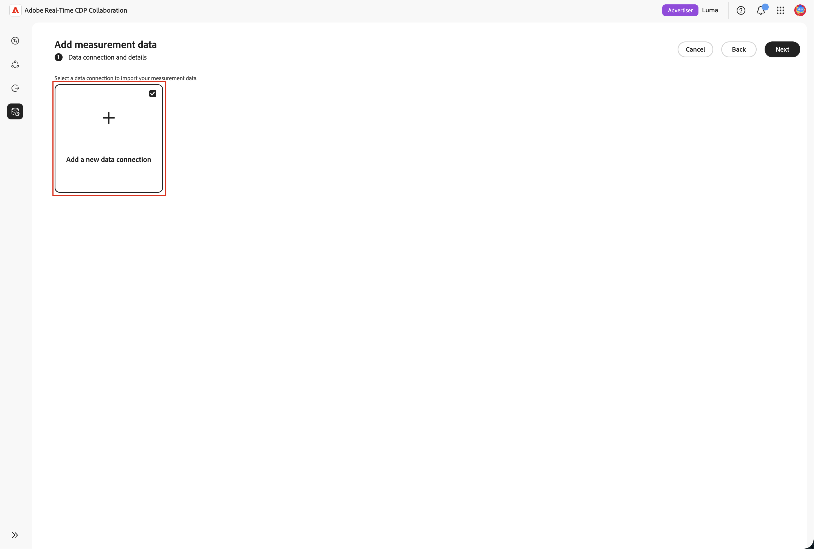

# 为广告曝光源配置[!DNL Azure]存储

将您的[!DNL Azure Data Lake Storage]或[!DNL Azure Blob Storage]帐户连接到Adobe Real-Time CDP Collaboration以获取源广告曝光（广告日志）数据进行测量。

Real-Time CDP Collaboration中的“测量”模块可将广告商转化数据与发布者广告曝光日志连接起来，以提供以隐私为中心的活动报告。 这为广告商和发布商添加了自助式无代码路径。 您可以将已在[!DNL Azure]中保留的广告曝光（展示）日志纳入归因的测量，无需Adobe Experience Platform依赖项。 您可以连接存储帐户、容器和路径，确认检测到的数据与测量预期的广告日志架构匹配，并在几分钟内完成。

连接时未提取数据。 来源补充是在运行测量报表时触发的。 为了最大限度地减少存储量，Adobe会在7天的保留期后自动删除源广告日志。

源自[!DNL Azure]的广告日志的治理和数据处理规则与适用于源自Adobe Experience Platform的数据的规则相匹配。

>[!NOTE]
>
>本指南涵盖来自云存储的来源广告商和发布商&#x200B;**广告日志** （广告泄露）。 即将从云存储中获取转化数据。

## 先决条件 {#prerequisites}

请先完成此部分中的所有项目，然后再启动配置工作流。 在遵循本指南之前，您必须已完成[帐户登录和设置](./onboard-account.md)。

### [!DNL Azure]访问和权限 {#azure-access-and-permissions}

在向导的&#x200B;**[!UICONTROL 同意]**&#x200B;步骤中，您或您的[!DNL Azure]管理员必须能够在存储帐户上分配&#x200B;**[!DNL Storage Blob Data Reader]**&#x200B;角色。 请参阅向导](#connect-adlogs)中的[连接广告日志。

### 准备广告日志数据 {#prepare-adlog-data}

在开始源之前，您的广告日志文件必须符合[广告日志架构](#ad-log-schema)。 主要要求包括：

* **文件格式：仅** CSV。
* **规范列标题：**&#x200B;文件必须使用[广告日志架构](#ad-log-schema)中定义的规范列标题。 此版本不支持每列重新映射或自动架构映射。
* **必填字段：**&#x200B;所有必填字段都必须存在，并且至少要有一个匹配键。
* **匹配键散列：**&#x200B;匹配键散列值必须为小写十六进制SHA-256。
* **列一致性：**&#x200B;配置路径上的每个文件都必须共享相同的列布局。
* **子文件夹：**&#x200B;文件必须直接位于指定的路径上。 Collaboration不会遍历子文件夹。

## 在向导中连接广告日志 {#connect-adlogs}

使用以下步骤可在Collaboration中连接[!DNL Azure]广告日志。

1. 从&#x200B;**[!UICONTROL 设置]**&#x200B;工作区中，选择&#x200B;**[!UICONTROL 我的测量数据]**，然后选择添加图标并选择&#x200B;**[!UICONTROL 测量数据]**。

   {zoomable="yes"}

2. 在&#x200B;**[!UICONTROL 添加测量数据]**&#x200B;工作流中，选择&#x200B;**[!UICONTROL Advertising暴露]**&#x200B;作为测量数据类型，然后选择&#x200B;**[!UICONTROL 下一步]**。

   {zoomable="yes"}

3. 要导入测量数据，请选择&#x200B;**[!UICONTROL 添加新数据连接]**，然后选择&#x200B;**[!UICONTROL 下一步]**。

   {zoomable="yes"}

4. 为新数据连接选择数据源： **[!UICONTROL Azure Blob Storage]**&#x200B;或&#x200B;**[!UICONTROL Azure Data Lake Storage Gen 2]**。 选择&#x200B;**[!UICONTROL 下一步]**。

   {zoomable="yes"}

5. 将打开&#x200B;**[!UICONTROL 添加数据连接]**&#x200B;向导。 在&#x200B;**[!UICONTROL 连接Azure存储]**&#x200B;步骤中，提供广告日志文件的生存位置&#x200B;**[!UICONTROL 存储帐户]**、**[!UICONTROL 容器]**、**[!UICONTROL 路径]**&#x200B;和&#x200B;**[!UICONTROL 租户ID]**。 所有字段都是必填字段，并且已配置路径中的所有文件都被视为一个数据集。

   {zoomable="yes"}

6. 在&#x200B;**[!UICONTROL 名称和描述]**&#x200B;步骤中，为数据连接提供&#x200B;**[!UICONTROL 数据连接名称]**（必需）和可选的&#x200B;**[!UICONTROL 描述]**。

   {zoomable="yes"}

7. 在&#x200B;**[!UICONTROL 同意]**&#x200B;步骤中，选择&#x200B;**[!UICONTROL 同意URL]**&#x200B;旁边的启动图标，以打开[!DNL Azure]授权页面并授予对列出的应用程序的访问权限。 将&#x200B;**[!DNL Storage Blob Data Reader]**&#x200B;角色分配给存储帐户上的该应用程序，然后返回Collaboration并选择&#x200B;**[!UICONTROL 下一步]**&#x200B;以验证访问权限。

   >[!NOTE]
   >
   >角色分配可能需要几分钟才能传播。 如果验证失败，请等待片刻，然后再次选择&#x200B;**[!UICONTROL 下一步]**。

   {zoomable="yes"}

8. 在&#x200B;**[!UICONTROL 映射字段]**&#x200B;步骤中，预览检测到的列以确认向导读取了正确的文件，然后查看[广告日志架构](#ad-log-schema)，该架构列出了测量所了解的每个字段、哪些字段是必填字段还是可选字段，以及检测到的列被识别为标识/匹配键。 此步骤为只读验证：系统会确认是否存在所需的标头，如果缺少必填字段，则会阻止您执行此操作。 此版本中没有按列重新映射。

   {zoomable="yes"}

9. 在&#x200B;**[!UICONTROL 审核]**&#x200B;步骤中，审核并完成。 该连接出现在测量数据区域中，其状态保持为&#x200B;**挂起**，直到第一个测量报告运行源数据为止。

## 广告日志源的工作方式 {#how-it-works}

来自[!DNL Azure]的广告日志源反映了用于受众源的高级别流程：

1. **云存储连接：**&#x200B;您配置了对保存广告日志的存储帐户或容器的只读访问权限。
2. **架构审查和验证：**&#x200B;系统根据ad日志架构（文件夹、文件和必需的标头检查；只读）验证您的文件。
3. **字段映射：**&#x200B;源标识字段根据规范列名自动映射到规范字段。 无需手动重新映射。
4. **摄取和标准化：**&#x200B;事件已标准化为每次曝光一行。 广告日志源在您运行测量报表时开始。

### 广告日志架构（规范CSV格式） {#ad-log-schema}

必填字段必须存在，并且下表中必须至少存在一个标记为&#x200B;**联接键（必填之一）**&#x200B;的字段。 匹配键哈希值为小写十六进制SHA-256。

| 字段 | 数据类型 | 必需 | 描述 |
| --- | --- | --- | --- |
| `EVENT_DATETIME` | 字符串(ISO 8601) | 必需 | 事件的时间戳 |
| `EVENT_ID` | 字符串 | 可选 | 事件的唯一ID |
| `EVENT_TYPE` | 字符串（枚举） | 必需 | 事件类型。 `{impression, click}`之一 |
| `HASHED_EMAIL_SHA_256` | 字符串（64字符十六进制） | 连接键（必需之一） | 电子邮件的小写十六进制SHA-256 |
| `HASHED_IPV4_SHA_256` | 字符串（64字符十六进制） | 连接键（必需之一） | IPv4的小写十六进制SHA-256 |
| `DEVICE_ID` | 字符串（64字符十六进制） | 连接键（必需之一） | 设备广告ID |
| `DEVICE_ID_TYPE` | 字符串（枚举） | 可选 | `{idfa, gaid, aaid, rida, afai, msai, vida, lgudid, tifa}`之一 |
| `ECID` | 字符串（64字符十六进制） | 连接键（必需之一） | 基于Demdex的ECID |
| `CUSTOM_ID` | 字符串 | 可选 | 发布者/合作伙伴永久ID（例如，PPID、RampID、核心ID） |
| `ADVERTISER_ID` | 字符串 | 必需 | 广告商的唯一标识符 |
| `ADVERTISER_NAME` | 字符串 | 可选 | 广告商/品牌名称 |
| `CAMPAIGN_ID` | 字符串 | 必需 | 平台特定的营销活动标识符 |
| `CAMPAIGN_NAME` | 字符串 | 可选 | 人工可读的营销活动名称 |
| `PLACEMENT_ID` | 字符串 | 必需 | 投放的唯一标识符 |
| `PLACEMENT_NAME` | 字符串 | 可选 | 描述性投放位置名称 |
| `CREATIVE_ID` | 字符串 | 可选 | 广告创意的唯一标识符 |
| `CREATIVE_NAME` | 字符串 | 可选 | 人类可读的创意名称 |
| `AUDIENCE_ID` | 字符串 | 可选 | 受众区段标识符 |
| `AUDIENCE_NAME` | 字符串 | 可选 | 易于用户识别的受众名称 |
| `DEVICE_TYPE` | 字符串（枚举） | 可选 | `{mobile, desktop, tablet, ctv, dooh, car, in_store, other}`之一 |
| `AD_FORMAT` | 字符串（枚举） | 可选 | `{display, video, native, audio, search, commerce, dooh, other}`之一 |
| `SITE_NAME` | 字符串 | 可选 | 发生展示的网络/站点/应用程序/发布者属性 |
| `TEST_GROUP` | 字符串 | 可选 | 提升研究、测试/控制、保留组分组 |
| `CUSTOM_DIM` | 字符串 | 可选 | 其他发布者维度 |

{style="table-layout:auto"}

>[!NOTE]
>
>`MATCH_KEY_TYPE`作为可选字段包含在架构中，以便随着时间的推移，可以并行支持多个ID类型，并且可以在不违反v1合同的情况下保留匹配密钥来源（电子邮件、电话或CRM）。

### 验证要求(v1) {#validation-requirements}

在完成设置工作流之前，系统会验证并记录源数据。 验证检查：

* 源文件夹必须至少包含一个文件。
* 文件不能为空。
* 必须存在所需的架构标头。
* 可省略可选的架构字段。
* 仅包含必填字段的文件有效。

验证失败会导致无法继续。 系统&#x200B;**不**&#x200B;验证数据类型、字段值、记录完整性、数据质量或自动架构映射。 对于此初始版本，验证仅限于文件夹、文件和必需的标头检查。

## 已知限制 {#known-limitations}

配置和使用[!DNL Azure]广告日志源时，请注意以下约束：

* **仅限广告日志：**&#x200B;此连接源广告商或发布商广告日志（广告公开）。 尚不支持转换数据。
* **支持的源：** [!DNL Azure Data Lake Storage]或[!DNL Azure Blob Storage]，以及[!DNL Google Cloud Storage]。
* **文件格式：仅** CSV。
* **需要规范标头：**&#x200B;没有按列重新映射，也没有智能/自动映射。 您的文件必须使用规范列名。
* **没有值/类型验证：**&#x200B;仅验证所需的列标题。 最初，可能没有数据行。
* **创建后不编辑连接：**&#x200B;任何更改（包括更改活动的匹配键）都需要创建新连接。
* **每个路径有一个布局：**&#x200B;路径上的所有文件必须共享一个相同的列布局。 混合布局可能会导致部分源失败。
* **未遍历的子文件夹：**&#x200B;文件必须直接位于指定的路径上。
* **运行测量报告时，没有计划或回看设置：**&#x200B;广告日志源开始。 在配置报表时设置回顾期间。
* **一个广告日志数据连接：**&#x200B;一次只配置一个广告日志数据连接。 测量报表会自动使用配置的连接。

## 故障排除 {#troubleshooting}

* **连接显示挂起/没有数据：**&#x200B;在第一次运行测量报告之前，这是预期情况。 连接时没有数据来源。
* **在源步骤**&#x200B;中“未找到数据”文件夹为空。 在继续之前添加文件。
* **预览未显示任何列：**&#x200B;文件存在但为空（没有标题或内容）。
* **无法获取过去的验证：**&#x200B;缺少所需的列标头。 使用规范名称确认必填字段和至少一个匹配键存在。
* **无法识别的列：**&#x200B;非规范列名称未提取为已知字段。 将它们重命名为规范格式；此版本中没有重新映射。
* **安装后源失败：**&#x200B;请确认Adobe对存储帐户或容器的读取权限未发生更改，并且文件仍以规范格式存在于配置的路径中。
* **报告日期范围未完全覆盖：**&#x200B;请记住7天自动数据过期。 超过7天的日志可能无法用于请求的范围。

## 升级或迁移注意事项 {#upgrade-migration}

* 之前通过Experience Platform或Adobe辅助设置载入的客户可以改用自助式云存储路径。 现有计量报告和流程保持不变。
* 必须为Collaboration帐户启用广告日志文件中存在的匹配键，就像受众源一样。
* 治理和数据处理规则与源自Experience Platform的数据相匹配。

## 后续步骤 {#next-steps}

完成来源补充后，您的广告日志可用于衡量报表。

有关其他广告曝光源方法，请参阅[为广告曝光源配置Google Cloud Storage ](./configure-gcs-adlog-sourcing.md)。
