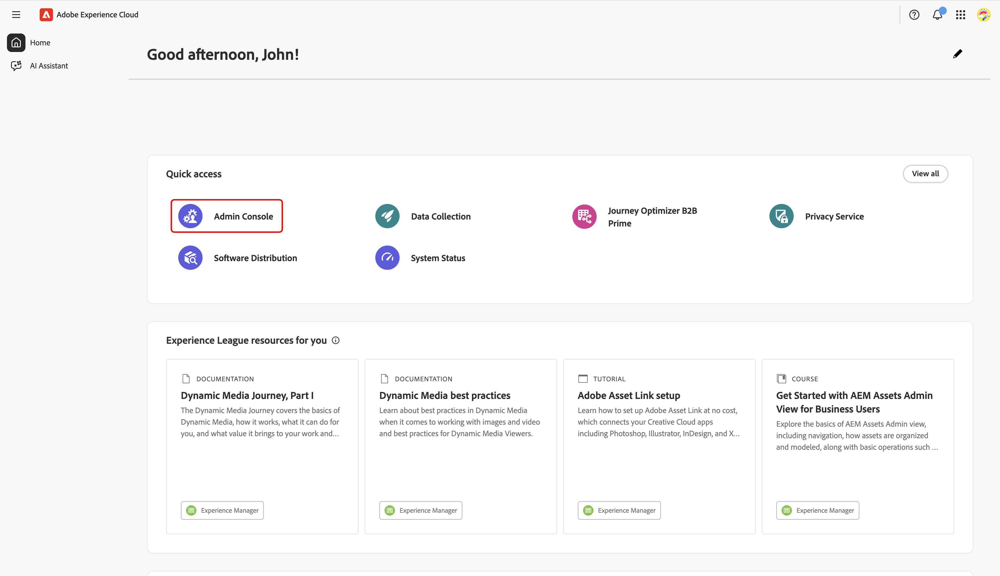
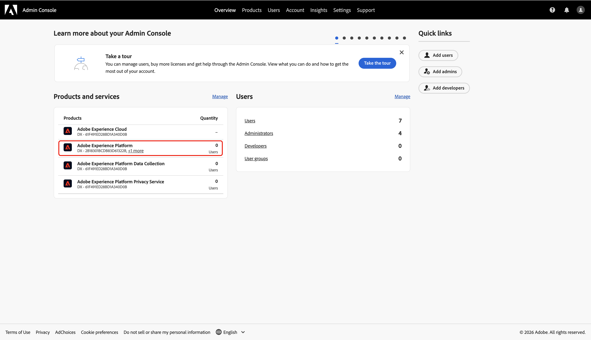
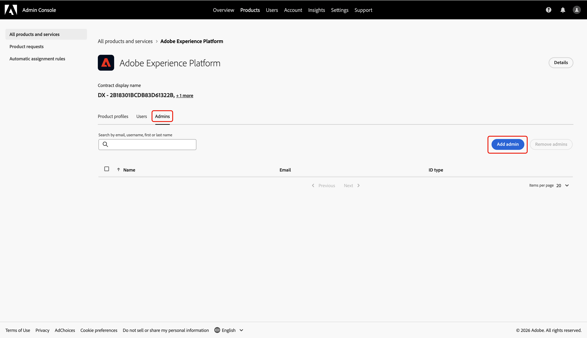
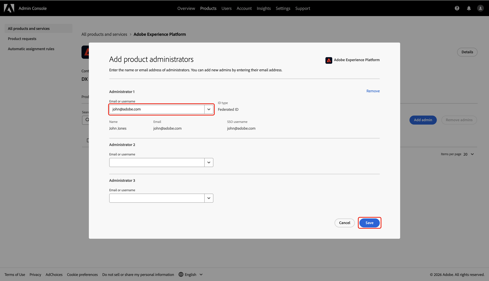
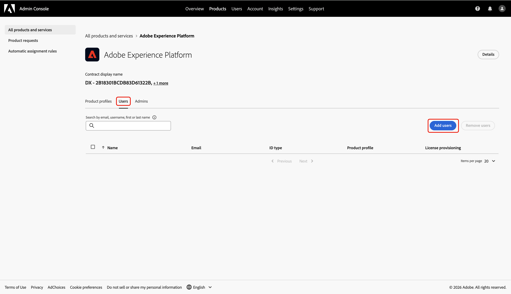
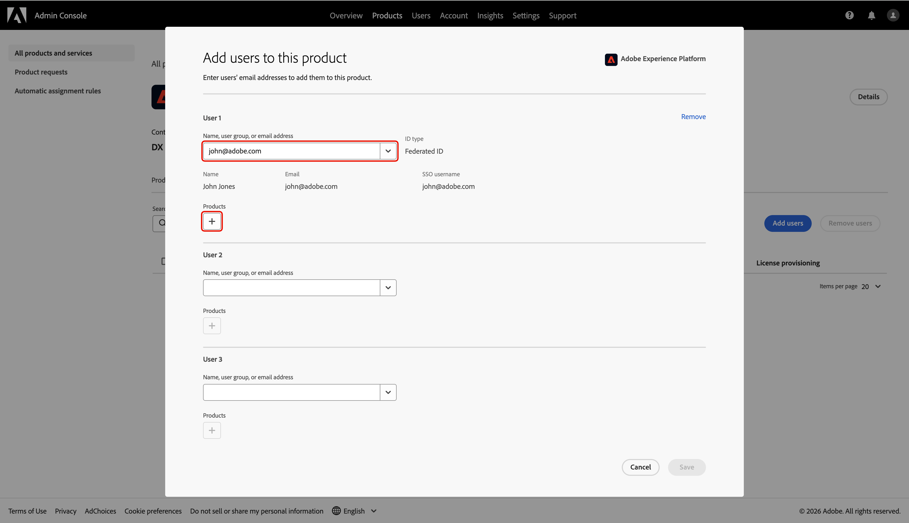
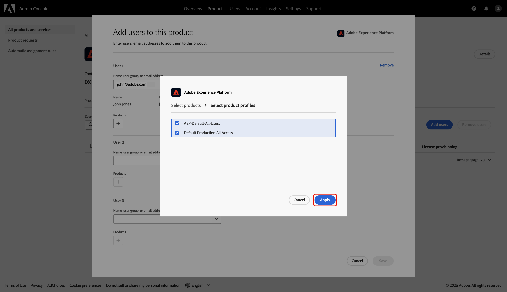
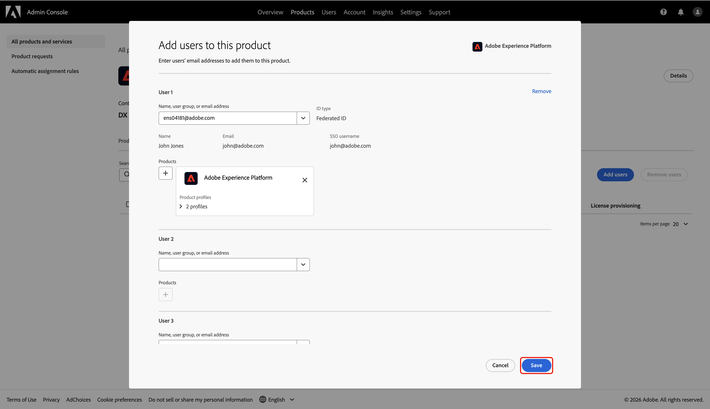
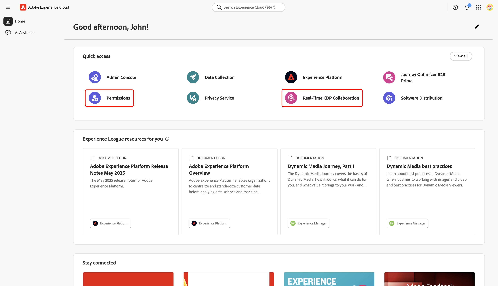

# 配置Collaboration [!DNL Starter]入门培训的管理员访问权限

作为贵组织中第一个通过Collaboration [!DNL Starter]访问Adobe Experience Platform的用户，您负责为团队设置和管理访问权限。 您必须授予自己必要的管理员和用户权限，才能开始使用Real-Time CDP Collaboration。 阅读本指南，了解如何在Admin Console中配置所需的访问权限，以便您可以在权限界面中管理协作权限。

## 先决条件 {#prerequisites}

在继续之前，请确保您具有：

* 已接受您的许可Collaboration合作伙伴的邀请。 有关邀请要求的详细信息，请参阅[Collaboration [!DNL Starter] 概述](../overview/starter-overview.md#prerequisites)。
* 审核并签署Collaboration条款和条件。
* 收到您的Adobe欢迎电子邮件并完成了您的首次帐户创建。

## 设置访问权限 {#setup-access}

通过[!DNL Starter]工作流创建Adobe帐户时，会自动为您分配系统管理员角色。 这允许您在Admin Console中管理用户和产品访问权限。 但是，您还没有访问&#x200B;**[!UICONTROL 权限]**&#x200B;的权限，这是管理Collaboration的访问权限所必需的。

使用Admin Console向自己授予对Experience Platform的&#x200B;**产品管理员访问权限**&#x200B;和对Experience Platform产品的&#x200B;**用户访问权限**，以进入&#x200B;**[!UICONTROL 权限]**。

要详细了解Experience Cloud中的角色和产品，请阅读[访问控制概述](../permissions/overview.md)文档。

>[!TIP]
>
>在本指南中，**管理员**&#x200B;将同时引用&#x200B;**系统和产品管理员**。

### 配置产品管理员访问权限 {#configure-product-admin-access}

请阅读此部分以授予您自己的管理员权限，开始设置Collaboration [!DNL Starter]的访问权限。

#### 访问Admin Console {#access-admin-console}

若要开始，请使用您的凭据登录到[Adobe Experience Cloud](https://experience.adobe.com/){target="_blank"}。 您可以在&#x200B;**[!UICONTROL 快速访问]**&#x200B;部分中看到可用产品的列表。 选择&#x200B;**[!UICONTROL Admin Console]**。

{zoomable="yes"}

#### 访问Adobe Experience Platform产品仪表板 {#access-adobe-experience-platform}

[Admin Console](https://adminconsole.adobe.com/)工作区将在新选项卡中打开。 从&#x200B;**[!UICONTROL 产品和服务]**&#x200B;下的&#x200B;**[!UICONTROL 产品]**&#x200B;列表中选择&#x200B;**[!UICONTROL Adobe Experience Platform]**。

{zoomable="yes"}

#### 添加产品管理员 {#add-product-admin}

在&#x200B;**[!UICONTROL Adobe Experience Platform]**&#x200B;产品仪表板中，导航到&#x200B;**[!UICONTROL 管理员]**&#x200B;选项卡。 然后选择&#x200B;**[!UICONTROL 添加管理员]**。

{zoomable="yes"}

在&#x200B;**[!UICONTROL 添加产品管理员]**&#x200B;对话框中输入您的电子邮件地址或用户名，然后从下拉列表中选择正确的帐户。 完成后，选择&#x200B;**[!UICONTROL 保存]**。

{zoomable="yes"}

您现在是产品管理员，可以在Admin Console中将用户或其他管理员添加到该产品。 接下来，授予您自己用户访问Experience Platform产品的权限，以便访问和执行权限中的功能。

### 配置用户访问权限 {#configure-user-access}

要管理Collaboration权限，除了具有管理员访问权限之外，您还必须具有产品的&#x200B;**用户访问权限**。 系统或产品管理员可以配置用户访问权限。

>[!TIP]
>
>如果您正在关注上一节的内容，则您应该已经位于Admin Console中的&#x200B;**[!UICONTROL Adobe Experience Platform]**&#x200B;产品仪表板中。 从此处，继续[将自己添加为用户](#add-user)。

要开始配置用户访问权限，请完成以下步骤：

1. [从Adobe Experience Cloud主页访问Admin Console](#access-admin-console)。
2. [导航到Adobe Experience Platform产品仪表板](#access-adobe-experience-platform)。

#### 将用户添加到产品 {#add-user}

您现在位于&#x200B;**[!UICONTROL Adobe Experience Platform]**&#x200B;产品仪表板中。 导航到&#x200B;**[!UICONTROL 用户]**&#x200B;选项卡，然后选择&#x200B;**[!UICONTROL 添加用户]**。

{zoomable="yes"}

出现&#x200B;**[!UICONTROL 将用户添加到此产品]**&#x200B;对话框，提示您输入姓名、用户组或电子邮件地址。 填写值，然后从下拉列表中选择您的帐户。

{zoomable="yes"}

接下来，选择&#x200B;**[!UICONTROL 产品]**&#x200B;下的添加图标。

此时将显示一个对话框，其中包含可用[产品配置文件](https://helpx.adobe.com/enterprise/using/manage-product-profiles.html)的列表。 选择&#x200B;**[!UICONTROL AEP-Default-All-Users]**&#x200B;和&#x200B;**[!UICONTROL 默认的生产所有访问]**。 然后选择&#x200B;**[!UICONTROL 应用]**。

{zoomable="yes"}

最后，选择&#x200B;**[!UICONTROL 保存]**&#x200B;以完成向产品添加新用户。

{zoomable="yes"}

获得用户访问权限后，导航回[Adobe Experience Cloud](https://experience.adobe.com/){target="_blank"}。 确认&#x200B;**[!UICONTROL 权限]**&#x200B;和&#x200B;**[!UICONTROL Real-Time CDP Collaboration]**&#x200B;在&#x200B;**[!UICONTROL 快速访问]**&#x200B;下可用。

{zoomable="yes"}

>[!TIP]
>
>如果&#x200B;**[!UICONTROL 权限]**&#x200B;和&#x200B;**[!UICONTROL Real-Time CDP Collaboration]**&#x200B;未出现在&#x200B;**[!UICONTROL 快速访问]**&#x200B;中，请尝试注销并重新登录。

## 后续步骤 {#next-steps}

您现在同时具有&#x200B;**管理员访问权限**&#x200B;和&#x200B;**用户访问权限**&#x200B;以输入权限，您可以在其中定义Collaboration功能和资源的角色、分配特定权限以及管理用户访问权限。 有关分步说明，请参阅[权限控制指南](./starter-permission-controls.md)。
