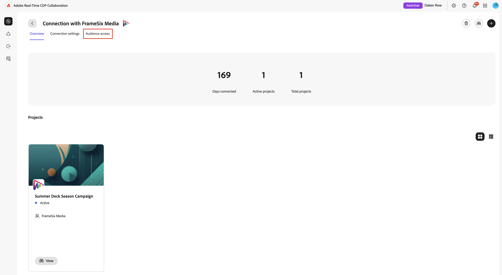
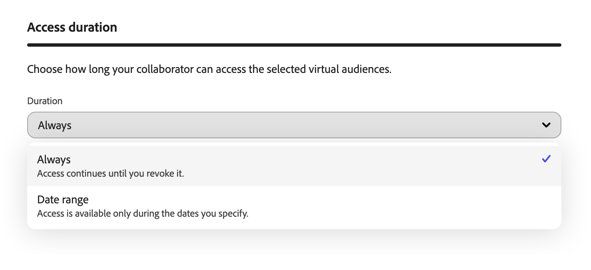
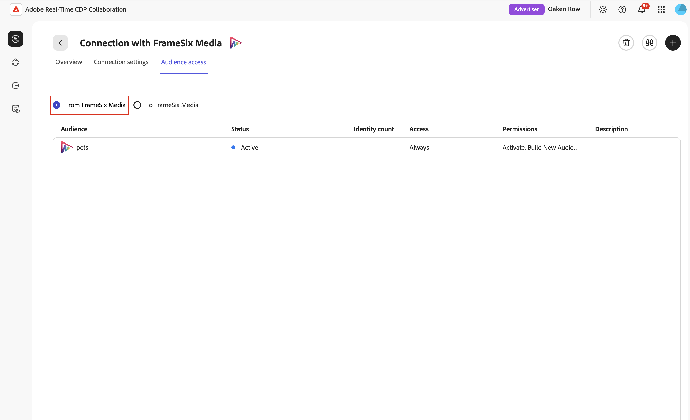

# RMN的虚拟受众访问（受众授权） {#virtual-audience-access}

要与连接的合作伙伴共享受众，请在[!DNL Adobe Real-Time CDP Collaboration]中使用虚拟受众访问。 受众授权通过持久引用为合作伙伴授予了访问所有受众群体的权限。 您保留所有权，授予访问权限时不会移动任何受众数据。

要使用共享受众，请在库存中找到虚拟受众。 使用受众在授予权限内进行激活或创建同类群组受众。 例如，零售媒体网络(RMN)可以授予广告商访问权，以便创建和激活同类群组受众。

## 受众访问概念 {#audience-access-concepts}

要了解您共享的内容以及合作伙伴可以如何使用受众，请查看以下术语。

| 术语 | 描述 |
| --- | --- |
| 提供商 | 拥有受众并控制访问权限的组织。 |
| 收件人 | 接收受众访问权限的已连接合作伙伴。 |
| 授权 | 访问共享受众，包括允许的使用和访问持续时间。 |
| 虚拟受众 | 对提供商拥有的受众的永久引用，可在收件人库存中使用。 |
| 完整人群 | 共享可授予对整个受众群体的访问权限。 |
| 连接范围 | 适用于提供商和收件人之间的连接的访问，而不是单个项目。 |

{style="table-layout:auto"}

要激活共享受众，您需要直接激活权限。

虚拟受众访问适用于连接。 在项目中共享是一个单独的工作流，不会将虚拟受众添加到收件人清单。

要通过现有协作项目激活受众，请参阅[发送并激活项目中的受众](/help/guide/collaborate/activate.md)。

## 先决条件 {#prerequisites}

在授予或使用虚拟受众访问权限之前，请确认您满足以下要求。

* 对于虚拟受众授权，与协作者](/help/guide/connect/establishing-connections.md)建立有效的[连接。
* 如果提供受众，请确认该受众可供共享。
* 要确认哪些操作可用，请查看授予与您共享的受众的权限。

**[!UICONTROL 共享受众]**&#x200B;对话框显示以下权限。 这两个权限均已选定且无法进行编辑。

| 受众权限 | 允许使用 |
| --- | --- |
| 直接激活 | 当受众满足激活要求时，在没有项目的情况下将共享受众激活到目标。 |
| [!UICONTROL 构建新受众] | 在构建受众时，使用共享受众作为输入。 |

{style="table-layout:auto"}

## 共享受众 {#share-an-audience}

要向连接的合作伙伴授予对选定受众的访问权限，请授予对完整群体的访问权限，并设置允许的使用和持续时间。 授予访问权限不会激活受众。

首先，打开&#x200B;**[!UICONTROL Connect]**&#x200B;工作区和收件人连接。

接下来，选择&#x200B;**[!UICONTROL 受众访问]**，然后选择与合作伙伴共享的受众选项。

选项包括合作伙伴名称。 在本例中，选择&#x200B;**[!UICONTROL 到FrameSix媒体]**。

然后，选择&#x200B;**[!UICONTROL 授予访问权限]**&#x200B;以打开&#x200B;**[!UICONTROL 共享受众]**&#x200B;对话框。

在&#x200B;**[!UICONTROL 受众]**&#x200B;中，从&#x200B;**[!UICONTROL Select受众]**&#x200B;中选择受众，或选择&#x200B;**[!UICONTROL 浏览受众]**。

选定的受众将显示在对话框中。 您的组织保留对受众的所有权和管理。

在“共享受众”对话框中

接下来，查看&#x200B;**[!UICONTROL 权限]**&#x200B;中显示的权限。 直接激活权限允许合作伙伴将虚拟受众激活到他们自己的目标。 **[!UICONTROL 构建新受众]**&#x200B;允许合作伙伴使用虚拟受众构建新受众。 这两个权限均已选定且无法进行编辑。

然后，从&#x200B;**[!UICONTROL 访问持续时间]**&#x200B;内的&#x200B;**[!UICONTROL 持续时间]**&#x200B;中选择一个选项以设置合作伙伴有权访问的时间。 Select **[!UICONTROL 始终]**&#x200B;无过期日期访问，或指定时间限制访问的日期。

最后，查看所选受众、权限和访问持续时间，然后选择&#x200B;**[!UICONTROL 授予访问权限]**。

**[!UICONTROL 受众访问]**&#x200B;选项卡列出了共享受众及其状态、身份计数、访问持续时间、权限和描述。

共享受众还会在收件人库存中显示为虚拟引用。 保留所有权。 如果授权允许激活，收件人可以单独激活受众。

## 查找和使用共享受众 {#find-and-use-shared-audiences}

作为收件人，在提供程序连接的&#x200B;**[!UICONTROL 受众访问]**&#x200B;选项卡中找到共享受众。 在授予权限内使用每个受众。

### 查找共享受众 {#find-shared-audiences}

要查找由提供商共享的受众并查看其访问详细信息，请打开提供商连接。 首先，打开&#x200B;**[!UICONTROL Connect]**&#x200B;工作区和提供程序连接。

接下来，选择&#x200B;**[!UICONTROL 受众访问]**，并为提供商共享的受众选择选项。

选项包含提供程序名称。 在此示例中，从FrameSix Media ]**中选择**[!UICONTROL 。

最后，查看共享受众及其访问详细信息。

### 生成受众 {#build-audiences}

要从共享受众构建受众，您需要&#x200B;**[!UICONTROL 构建新受众]**&#x200B;权限。 例如，将共享受众与您自己的受众相结合，以创建新受众。

新受众属于您。 提供商保留对源受众的所有权。

### 激活共享受众 {#activate-shared-audiences}

要直接激活虚拟受众，请确认授权符合这些条件。

| 要求 | 条件 |
| --- | --- |
| 共享类型 | 完整人群 |
| 受众权限 | 您具有受众的直接激活权限。 |
| 授予状态 | 活动。 访问是无限期的，或在指定的日期范围内。 |

{style="table-layout:auto"}

若要将符合条件的受众发送到目标，请使用&#x200B;**[!UICONTROL 激活]**&#x200B;页面。 您不需要项目。

有关详细信息，请参阅[直接激活受众(Beta)](/help/guide/destinations/direct-audience-activation.md)。

如果受众不符合要求，则无法选择要直接激活的受众。 Collaboration在每次计划激活运行时再次检查资格。

## 管理受众访问 {#manage-audience-access}

作为提供商，您可以控制访问持续时间。 只有您可以更改授权到期或撤销访问权限。

### 访问持续时间 {#access-duration}

创建授权时选择访问持续时间。

| 持续时间 | 行为 |
| --- | --- |
| [!UICONTROL 始终] | 访问不会自动过期。 您可以撤销授权。 |
| 日期范围 | 访问持续指定的日期范围。 Collaboration每小时处理一次过期事件。 |

{style="table-layout:auto"}

要延长访问权限，请设置未来的过期日期或将持续时间更改为无限期访问。 这两个更改都会重新激活已过期的授权。

### 访问过期 {#access-expiration}

Collaboration每小时检查一次过期的授权。 当Collaboration将授权标记为已过期时，收件人将失去对受众的虚拟访问权限。

### 撤销访问权限 {#revoke-access}

要立即删除虚拟访问权限，请撤销活动或过期的授权。

## 后续步骤 {#next-steps}

授予或接收受众访问权限后，请使用以下指南准备激活或管理Collaborator连接。

* [配置和管理目标](/help/guide/destinations/manage-destinations.md)
* [管理协作者连接](/help/guide/connect/manage-connections.md)
